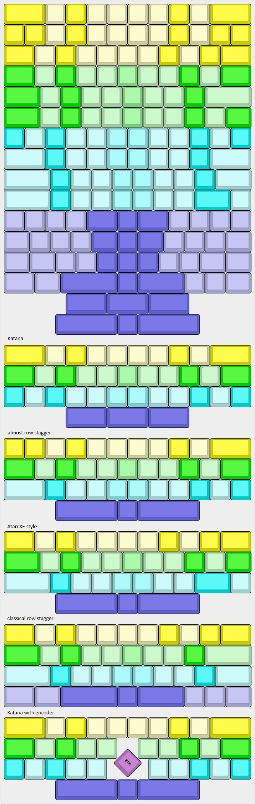

# AtaKi
Wireless universal 40% keyboard in a 12x4U format, including mounting holes for BM40 cases and gaskets.
Will be using ZMK on a nice!nano

The PCB supports multiple configurations, including Katana with 0.5U indent and QAZ, also multiple bottow row configs are possible.
(almost) all switches are mounted sideways to have better stability with the overlapping footprints. Also it's no clearance problem with tested switches/caps and it supports the modified Selectric keycaps (see https://github.com/Tschibo00/qmk/tree/main/hacktrick for details on the idea)

## WARNING
**This project is a personal project, i just built one prototype. It's not considered complete, nor tested or error-free.**

**I won't develop this much, just releasing it as-is for anybody knowledgable picking up and maybe building upon it.**

**It is NOT ready to take the files and produce a working keyboard!**

## How to build
To not struggle when soldering, it should be done in the following order:
- solder all diodes (and resistor if equipped) first
- solder the two switches on opposite of MCU
  - if you want to put the MCU as low as possible, cut the pins of the switches first to sit quite flush with the PCB
- solder the MCU
  - put the short ends of the headers through the PCB, long end goes through the MCU
  - if you want to put the MCU flush down, solder headers to PCB first, then remove the spacers on the headers. Put MCU on and solder, clip headers
- solder remaining switches
  - triple-check with every row that your soldering the correct layout. put the required caps on the switches to see, which holes you need to solder to

## Special considerations for the Atari 130XE "replica" layout
- The Atari has an unusual layout which leads to skipped columns in the keyboard matrix, take notes in the overlay file.
- columns 12/13 are used for the joystick ports only. These must be soldered directly to the nice!nano pads p1.01 and p1.02 (not broken out as pins!)
- The function keys breakout board needs to be soldered to the respective columns and to row 4. Easily done by scraping off solder mask on the long r4 line at top of PCB
- The Atari keys need adapters for MX stems. The case already accounts for the taller keys
- The 3u keys also need a MX-MX adapter to achieve the same height

# Todos
- [x] add PCB artwork
- [x] order the thing
- [x] hack firmware
- [x] design Atari 130XE style case including function keys
- [ ] boast about it on r/mk
- [x] fix PCB (esp. encoder mount pads)
- [x] add note to U1 to put nano on bottom side
- [x] add traces to daughter board
- [x] add missing Atari footprints
- [x] move name+link to central bottom row, enlarge a bit
- [x] move reset switch because it's blocking the usb
- [x] add joystick ports
- [x] create base keymap
- [x] create additional keymaps, e.g. Katana
- [x] add LED connector
- [ ] fix Joystick connection, ~~using r5/r6, swapping column/row~~ change to unused columns
- [ ] add function board connector to PCB
- [ ] Change battery connector to use PH2.0 on PCB
- [ ] add function keys: "help", tbd, CtrlX+M, tbd, tbd
- [ ] increase delay in sequences
